# ICAS Student Life Assistant

**One place for ICAS students to manage the 2+2 transfer, their courses and campus life, with AI help for the tedious parts.**


Built by **Team AXION** (Jeevith · Shiva Teja · Ali · Charan · Hitesh) for the **Enigma Hackathon 2025**.

> **Challenge:** _"Build something that improves the daily life of ICAS students."_

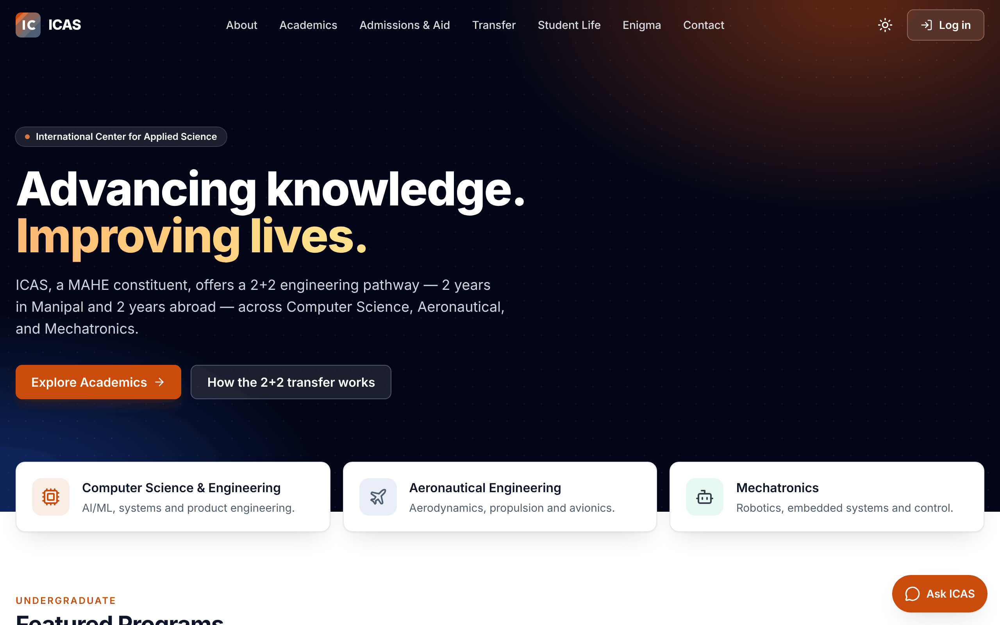

---

## Contents

- [Overview](#overview)
- [Screenshots](#screenshots)
- [Features](#features)
- [Tech stack](#tech-stack)
- [Architecture](#architecture)
- [Project structure](#project-structure)
- [Getting started](#getting-started)
- [Configuration](#configuration)
- [Usage](#usage)
- [Scripts](#scripts)
- [API reference](#api-reference)
- [Design system and accessibility](#design-system-and-accessibility)
- [Testing](#testing)
- [Linting and formatting](#linting-and-formatting)
- [Deployment](#deployment)
- [Troubleshooting and FAQ](#troubleshooting-and-faq)
- [Known limitations](#known-limitations)
- [Roadmap ideas](#roadmap-ideas)
- [Contributing](#contributing)
- [License](#license)
- [Credits](#credits)

---

## Overview

Students at ICAS (International Centre for Applied Sciences, Manipal) follow a **2+2 transfer programme**: two years in India, then two years at a partner university abroad. The transfer brings deadlines, document checklists, GPA cutoffs and information spread across many places.

This project brings that together:

- A **public site** that explains the programmes and the 2+2 pathway, with a searchable list and map of 100+ partner universities.
- A **student portal** with a dashboard, course submissions, a transfer tracker (documents, eligibility, deadlines, timeline) and an AI transfer assistant.
- An **AI meeting summariser** that turns a recorded delegate session into a transcript plus decisions, action items and next steps.
- **Cloud-backed tools** (Study Centre, Academic Planner, Buddy System, Research Hub) that use Firebase when it is configured.

**Who it is for:** ICAS students planning a transfer, the student delegates who run meetings, and the staff who support them. It is also a reference for anyone building a similar React + Express + Firebase app.

**Two run modes.** With no configuration, the app runs in **demo mode**: accounts live in your browser's `localStorage` and the Firebase-only tools show a "setup required" screen. Add Firebase credentials to switch to **Firebase mode** with real authentication and cloud storage. The AI features work in either mode once their API keys are set on the server.

---

## Screenshots

All screenshots were captured from a local production build (`pnpm build && pnpm start`) in demo mode, signed in as the seeded demo student. No real student data is shown.

| Home (dark mode)                                          | Log in                                    |
| --------------------------------------------------------- | ----------------------------------------- |
| 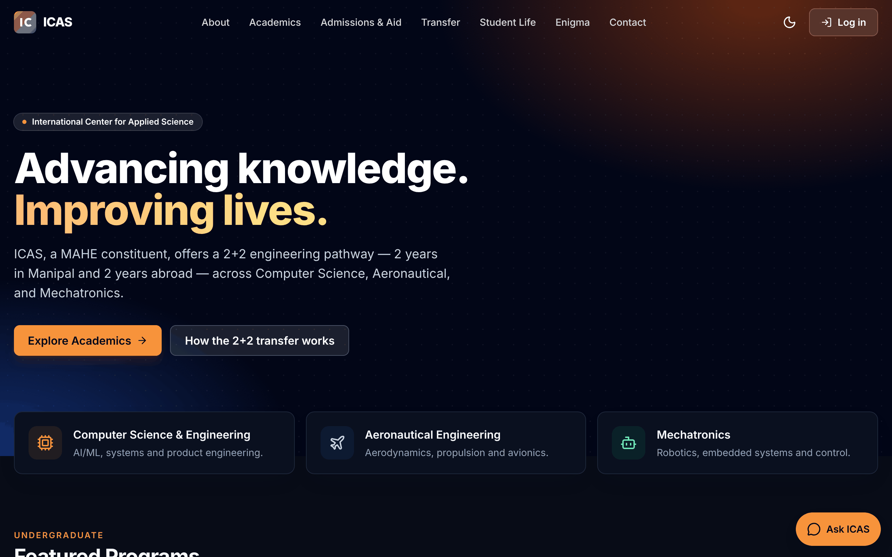 | 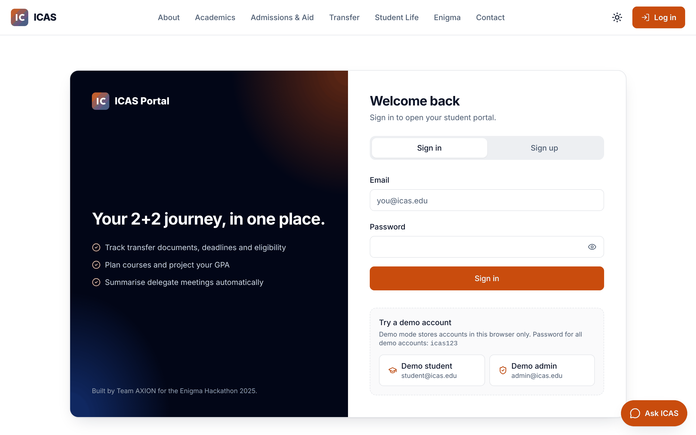 |

| Student portal dashboard                                           | Portal dashboard (dark mode)                                                 |
| ------------------------------------------------------------------ | ---------------------------------------------------------------------------- |
| 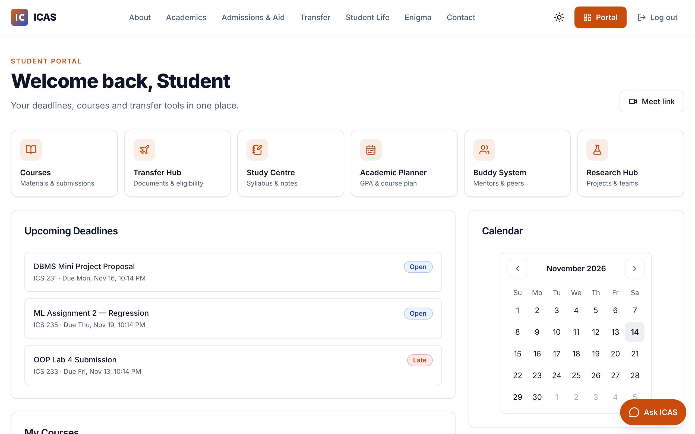 | 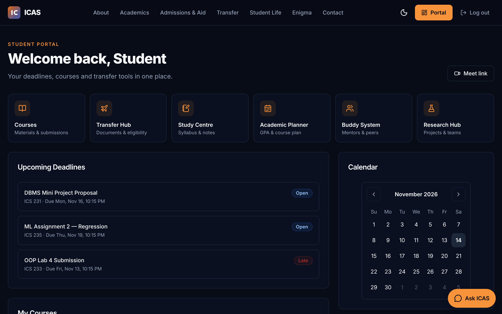 |

| Smart Transfer Portal                                          | Course page with assignment submission      |
| -------------------------------------------------------------- | ------------------------------------------- |
| 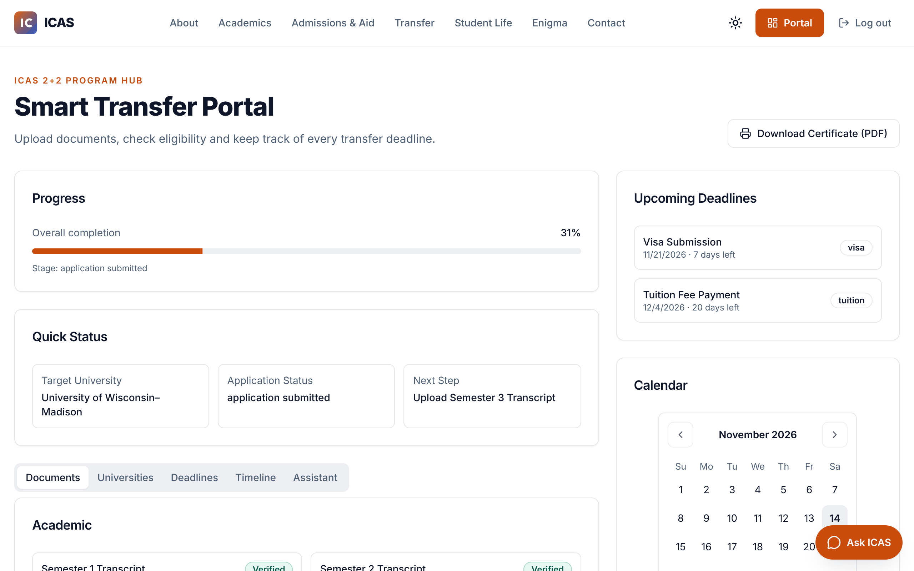 | 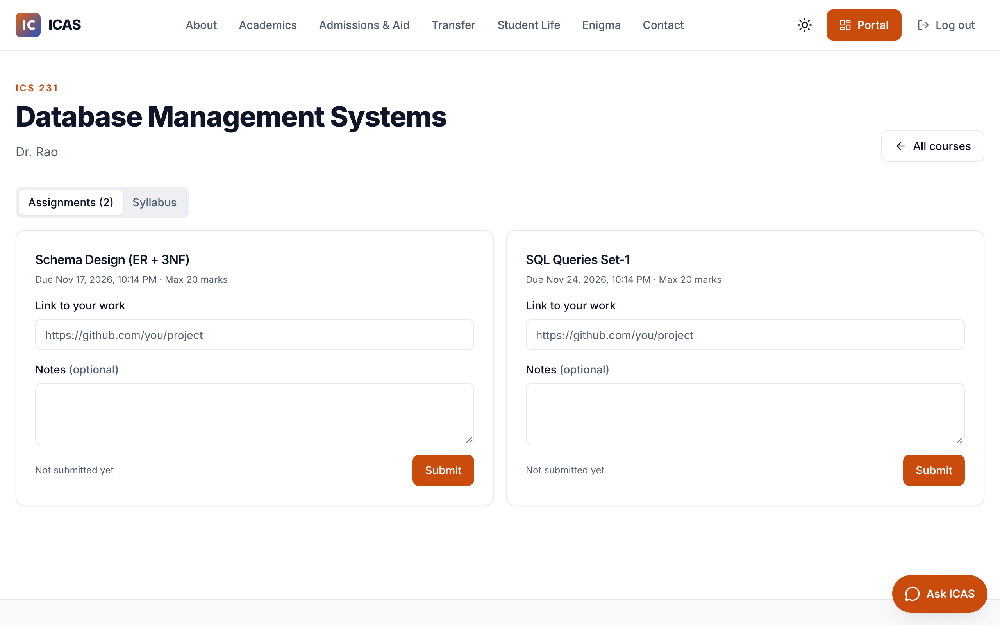 |

| Partner-university search                                  | Contact form validation                                                            |
| ---------------------------------------------------------- | ---------------------------------------------------------------------------------- |
| 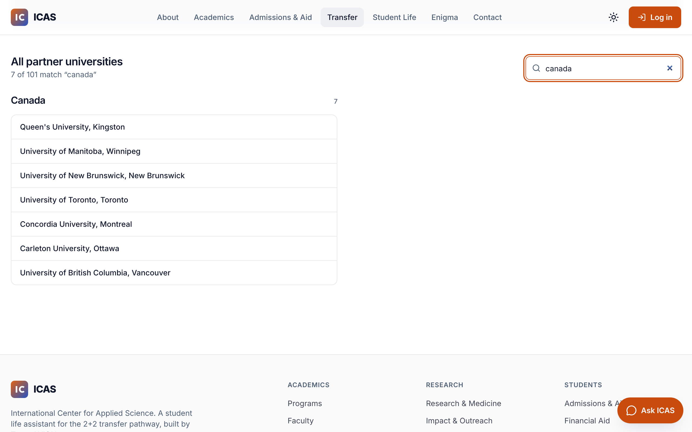 | 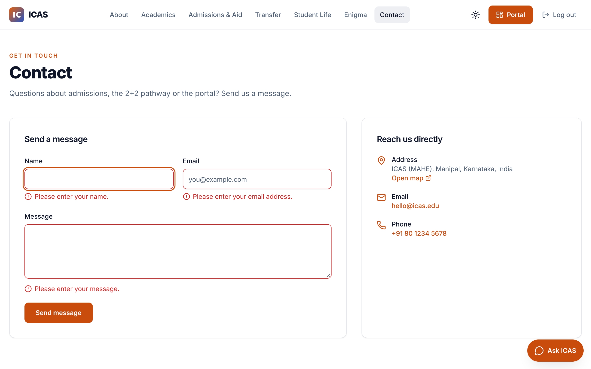 |

| "Ask ICAS" navigator                                  | 404 page                                          |
| ----------------------------------------------------- | ------------------------------------------------- |
| 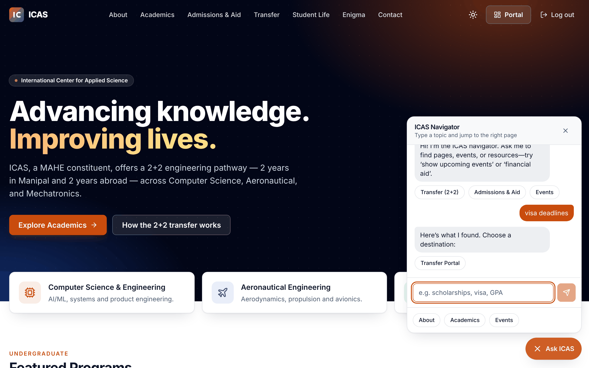 | 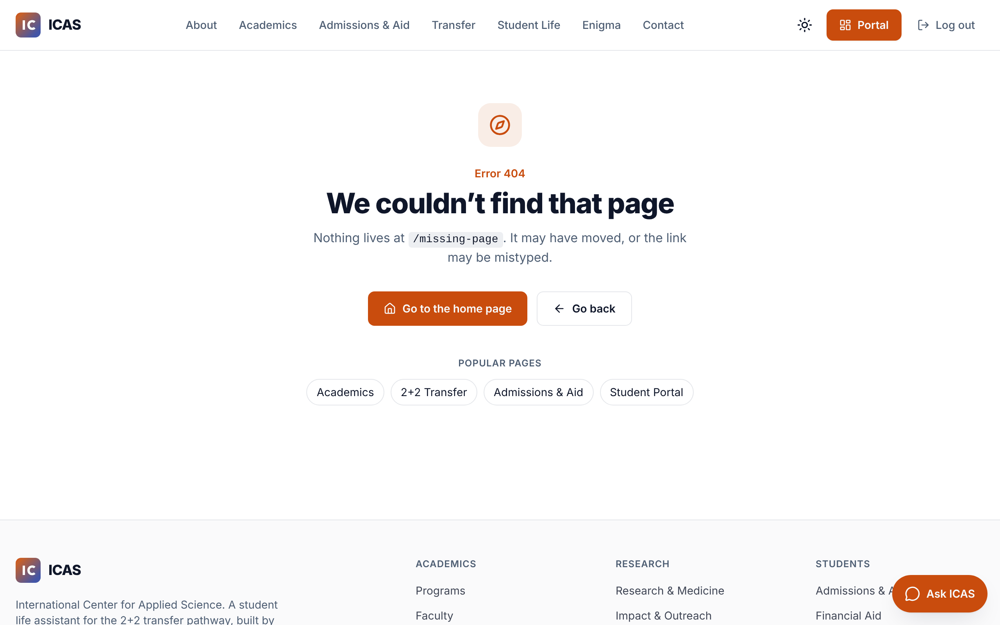 |

**On a phone (iPhone 13 viewport):**

| Home                                                                                | Navigation drawer                                                                       | Portal                                                                             |
| ----------------------------------------------------------------------------------- | --------------------------------------------------------------------------------------- | ---------------------------------------------------------------------------------- |
| 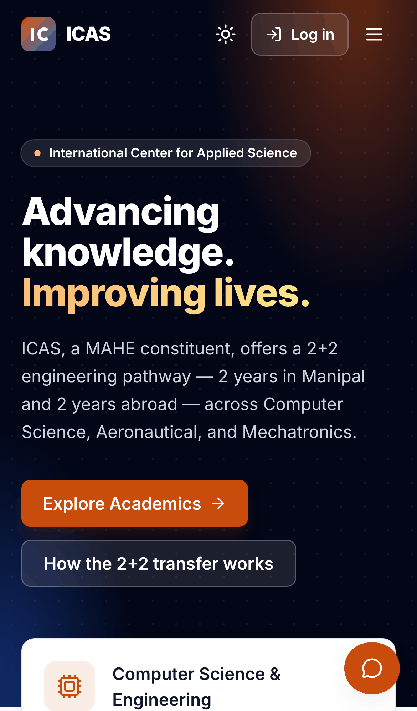 | 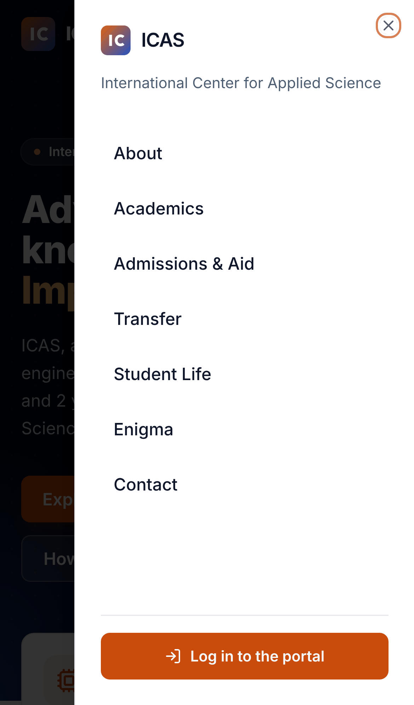 | 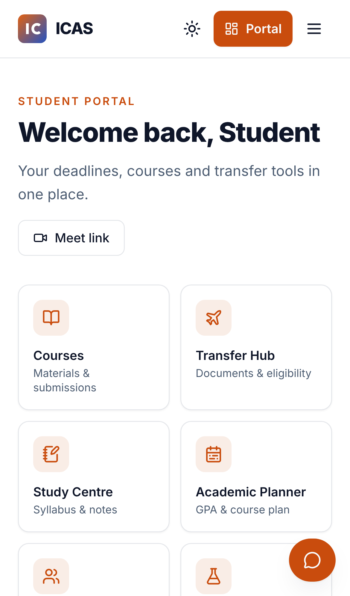 |

---

## Features

### Public site

- **Content pages:** Home, About, Academics, Research & Medicine, Student Life, Events, News, Faculty, Admissions & Aid, Financial Aid, Medical Aid, Impact & Outreach, Enigma club and Contact.
- **2+2 Transfer page** (`/transfer`): a four-step overview of the pathway, an interactive Leaflet map of partner universities (loaded only when scrolled into view, with loading and error states), and a **searchable list of 101 universities across 11 countries and regions** with a live result count and an empty state.
- **"Ask ICAS" navigator:** a floating helper that maps what you type (for example "scholarships", "visa", "gpa") to the right page. It runs entirely in the browser using keyword matching; it does not call an AI model.
- **Contact and newsletter forms** with inline validation messages. There is no mail backend yet, so both confirm in the page and say so.
- **Light and dark themes** (follows your system setting, remembered after you toggle), a responsive layout with a mobile navigation drawer, a skip-to-content link and a friendly 404 page.

### Student portal (sign-in required)

| Feature                                                                                                                                                                                      | Route                  | Storage                                                        |
| -------------------------------------------------------------------------------------------------------------------------------------------------------------------------------------------- | ---------------------- | -------------------------------------------------------------- |
| **Dashboard:** greeting, tool shortcuts, upcoming deadlines with status, course progress, calendar, announcements, grades snapshot                                                           | `/portal`              | Sample data                                                    |
| **Courses:** course list, per-course syllabus, assignment submission (link + notes) with URL validation and "last submitted" status                                                          | `/portal/courses`      | Browser `localStorage`                                         |
| **Smart Transfer Portal:** document checklist with file-name validation, eligibility check against partner GPA cutoffs, deadline countdowns, progress score, timeline, AI Transfer Assistant | `/portal/transfer`     | `localStorage` in demo mode; Firestore + Storage with Firebase |
| **Delegate Sessions Summary:** upload a meeting recording and get a transcript plus a structured summary (overview, attendees, agenda, decisions, action items, risks, next steps, timeline) | on `/portal`           | Processed on the server, not stored                            |
| **Study Centre:** per-course syllabus, rich-text notes (sanitised with DOMPurify), file uploads                                                                                              | `/portal/study-centre` | Firebase                                                       |
| **Academic Planner:** GPA calculator, what-if scenarios, course recommendations by prerequisite and semester, transfer-credit check                                                          | `/portal/planner`      | Firebase                                                       |
| **Buddy System:** mentor/mentee profiles, matching, chat                                                                                                                                     | `/portal/buddies`      | Firebase                                                       |
| **Research Hub:** post projects, apply, team updates                                                                                                                                         | `/portal/research-hub` | Firebase                                                       |
| **Admin dashboard** (admins only): placeholder cards marked "Coming soon"                                                                                                                    | `/admin`               | —                                                              |

### Security and robustness

- One `AuthProvider` for both modes; protected routes redirect to `/login?next=…` and the redirect target is restricted to same-origin paths (no open redirect).
- The AI endpoints validate input with Zod, enforce size limits, are rate-limited per IP, and never forward upstream error bodies to the browser.
- Firestore and Storage security rules scope data to the signed-in user, and self-signup can only create the `student` role.
- Route-level code splitting, an error boundary with recovery actions, and loading states for lazy pages and session restore.

---

## Tech stack

| Layer           | Technology                                                                                                                    |
| --------------- | ----------------------------------------------------------------------------------------------------------------------------- |
| UI              | React 18, TypeScript 5, React Router 7, Tailwind CSS 3, Radix UI primitives (shadcn/ui), Lucide icons, Sonner toasts          |
| Data fetching   | TanStack Query (provider), `fetch`                                                                                            |
| Maps            | Leaflet 1.9 (loaded on demand from unpkg) with CARTO basemap tiles                                                            |
| Build / dev     | Vite 7 with SWC; the Express API runs inside the Vite dev server                                                              |
| Backend         | Express 5, Zod 4 validation, `express-rate-limit`, CORS, `serverless-http` for Netlify                                        |
| Auth & data     | Firebase Authentication, Cloud Firestore, Firebase Storage (optional; demo mode uses `localStorage`)                          |
| AI services     | [OpenRouter](https://openrouter.ai) for chat and summarisation, [ElevenLabs](https://elevenlabs.io) Scribe for speech-to-text |
| Testing         | Vitest 4, Supertest                                                                                                           |
| Code quality    | ESLint 10 (typescript-eslint, react-hooks, react-refresh), Prettier 3                                                         |
| Package manager | pnpm 10 (pinned via `packageManager`)                                                                                         |

---

## Architecture

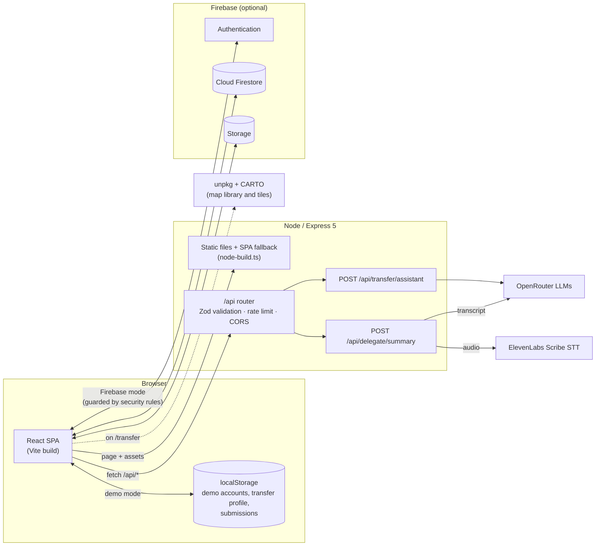

How the pieces fit:

1. **The SPA talks to Firebase directly** from the browser. Access control lives in [`firestore.rules`](firestore.rules) and [`storage.rules`](storage.rules), not in the Express server.
2. **The Express API exists only for calls that need private keys** (OpenRouter, ElevenLabs). Keys never reach the browser.
3. **One server in production.** `pnpm start` serves the built SPA from `dist/spa`, handles `/api/*`, returns a JSON 404 for unknown API routes and falls back to `index.html` for client routes. In development, the same Express app is mounted as Vite middleware, so `pnpm dev` gives you the SPA and the API on one port.
4. **Demo vs Firebase mode** is decided at build time: if the `VITE_FIREBASE_*` variables are present, Firebase is initialised; otherwise demo mode is used and Firebase-only routes render a setup notice via `RequireFirebase`.

**Meeting-summary pipeline** (`POST /api/delegate/summary`):

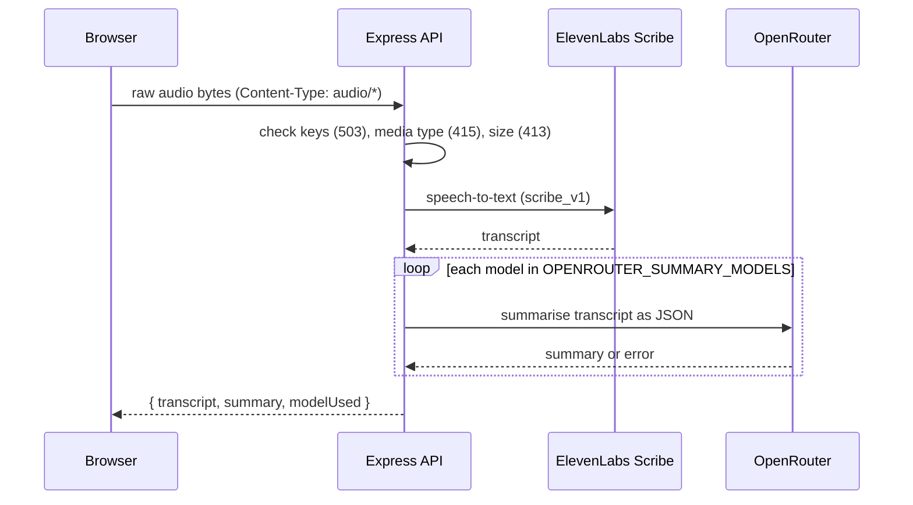

---

## Project structure

```
.
├── client/                         React SPA
│   ├── App.tsx                     Router, providers, lazy-loaded routes
│   ├── global.css                  Design tokens (light/dark), base styles, shared component classes
│   ├── components/
│   │   ├── ai/AiNavBot.tsx         "Ask ICAS" keyword navigator
│   │   ├── auth/                   Protected, RequireRole, RequireFirebase guards + loading state
│   │   ├── layout/                 Header (mobile drawer, theme toggle), Footer, Logo, SiteLayout
│   │   ├── sections/               Home and portal sections (incl. DelegateSessionsSummary)
│   │   ├── theme/                  ThemeProvider and ThemeToggle
│   │   ├── ui/                     shadcn/ui primitives (Radix-based)
│   │   ├── PageHeader.tsx          Shared page title block
│   │   ├── EmptyState.tsx          Shared empty/no-results placeholder
│   │   ├── FieldError.tsx          Accessible inline form error
│   │   ├── UniversityMap.tsx       Lazy Leaflet map with loading/error states
│   │   ├── ErrorBoundary.tsx       Render-error recovery screen
│   │   └── SEO.tsx                 Per-page title, description and social tags
│   ├── context/AuthContext.tsx     Unified auth: Firebase or local demo mode
│   ├── data/sample.ts              Sample content, partner universities, demo accounts
│   ├── hooks/                      use-simple-form (validation), use-toast, use-mobile
│   ├── lib/                        Domain logic: transfer, planner, buddy, research, study centre, auth helpers
│   └── pages/                      One component per route
├── server/
│   ├── index.ts                    Express app: middleware, routes, error handling
│   ├── node-build.ts               Production entry: static SPA + API + graceful shutdown
│   ├── lib/                        OpenRouter client, LLM JSON parsing, audio helpers, error types
│   └── routes/                     transfer-assistant.ts, delegate-summary.ts
├── shared/api.ts                   Request/response types shared by client and server
├── netlify/functions/api.ts        Netlify Function wrapper around the Express app
├── public/                         Logo, favicons, Open Graph image, robots.txt
├── docs/screenshots/               README screenshots
├── firestore.rules                 Firestore security rules
├── storage.rules                   Storage security rules
├── firebase.json                   Points the Firebase CLI at the rules files
├── netlify.toml                    Netlify build, function and redirect config
├── vite.config.ts                  Client build + dev server (mounts the Express app)
├── vite.config.server.ts           Server build (dist/server/node-build.mjs)
├── tailwind.config.ts              Theme mapping for the CSS tokens
├── eslint.config.js                ESLint flat config
└── .env.example                    Every supported environment variable
```

---

## Getting started

### Prerequisites

| Tool     | Version                            | Notes                                                           |
| -------- | ---------------------------------- | --------------------------------------------------------------- |
| Node.js  | **22 or newer**                    | Enforced by `engines` in `package.json`                         |
| pnpm     | **10** (10.14.0 is pinned)         | Run `corepack enable` once and Node will use the pinned version |
| Git      | any recent version                 |                                                                 |
| Optional | OpenRouter and ElevenLabs API keys | Only needed for the AI Transfer Assistant and meeting summaries |
| Optional | A Firebase project                 | Only needed for Firebase mode (real auth and the cloud tools)   |

### Installation

```bash
# 1. Clone
git clone https://github.com/jeevithg090/Axion-ICAS-Hacks.git
cd Axion-ICAS-Hacks

# 2. Use the pinned pnpm version
corepack enable

# 3. Install dependencies (exactly as locked)
pnpm install --frozen-lockfile

# 4. Optional: configure keys
cp .env.example .env
#    then edit .env (see Configuration below)

# 5. Start the dev server (SPA + API on one port)
pnpm dev
```

Open <http://localhost:8080>. With an empty `.env` you are in demo mode.

### Demo accounts

In demo mode these accounts are seeded into your browser. You can also register a new student from the **Sign up** tab.

| Role      | Email              | Password  | Lands on  |
| --------- | ------------------ | --------- | --------- |
| Student   | `student@icas.edu` | `icas123` | `/portal` |
| Professor | `prof@icas.edu`    | `icas123` | `/portal` |
| Admin     | `admin@icas.edu`   | `icas123` | `/admin`  |

The login page also has one-click **Demo student** and **Demo admin** buttons (shown in demo mode only).

### Running in production locally

```bash
pnpm build            # SPA → dist/spa, server → dist/server/node-build.mjs
pnpm start            # http://localhost:3000 (or $PORT)
```

---

## Configuration

All variables are listed in [`.env.example`](.env.example). Server variables are read at runtime from the process environment (and from `.env` in development). `VITE_*` variables are embedded into the browser bundle **at build time**, so changing them requires a rebuild.

### Server (secret, never exposed to the browser)

| Variable                     | Required?             | Default                     | Description                                                                                    |
| ---------------------------- | --------------------- | --------------------------- | ---------------------------------------------------------------------------------------------- |
| `OPENROUTER_API_KEY`         | For AI features       | —                           | Enables the Transfer Assistant and meeting summaries. Without it those endpoints return `503`. |
| `ELEVENLABS_API_KEY`         | For meeting summaries | —                           | Speech-to-text for Delegate Sessions Summary. Without it the summary endpoint returns `503`.   |
| `OPENROUTER_ASSISTANT_MODEL` | No                    | `openrouter/auto`           | Model used by the Transfer Assistant.                                                          |
| `OPENROUTER_SUMMARY_MODELS`  | No                    | Built-in list of six models | Comma-separated models tried in order for summaries until one succeeds.                        |
| `APP_URL`                    | No                    | —                           | Public URL of your deployment, sent to OpenRouter as `HTTP-Referer`.                           |
| `CORS_ORIGINS`               | No                    | empty (same-origin only)    | Comma-separated extra origins allowed to call the API.                                         |
| `AI_RATE_LIMIT_PER_MINUTE`   | No                    | `10`                        | Requests per minute per IP for the AI endpoints.                                               |
| `MAX_AUDIO_UPLOAD`           | No                    | `25mb`                      | Maximum recording size for meeting summaries (Express `raw` limit syntax).                     |
| `TRUST_PROXY`                | No                    | `1`                         | Reverse-proxy hops to trust when reading client IPs (matters for rate limiting).               |
| `PORT`                       | No                    | `3000`                      | Port for `pnpm start`. The dev server always uses `8080`.                                      |
| `PING_MESSAGE`               | No                    | `ping`                      | Message returned by `GET /api/ping` (handy for health checks).                                 |

### Client (embedded at build time)

Leave all of these empty for demo mode. Fill them from your Firebase web app's config for Firebase mode.

| Variable                            | Required?         | Default | Description                         |
| ----------------------------------- | ----------------- | ------- | ----------------------------------- |
| `VITE_FIREBASE_API_KEY`             | For Firebase mode | —       | Firebase web API key                |
| `VITE_FIREBASE_AUTH_DOMAIN`         | For Firebase mode | —       | e.g. `your-project.firebaseapp.com` |
| `VITE_FIREBASE_PROJECT_ID`          | For Firebase mode | —       | Firebase project ID                 |
| `VITE_FIREBASE_STORAGE_BUCKET`      | For Firebase mode | —       | Storage bucket name                 |
| `VITE_FIREBASE_MESSAGING_SENDER_ID` | For Firebase mode | —       | Messaging sender ID                 |
| `VITE_FIREBASE_APP_ID`              | For Firebase mode | —       | Web app ID                          |
| `VITE_FIREBASE_MEASUREMENT_ID`      | No                | —       | Analytics measurement ID            |

> Firebase web config is **not** a secret; it ships to every browser by design. Protect your data with the security rules and, ideally, [App Check](https://firebase.google.com/docs/app-check). Never put server keys in a `VITE_` variable.

### Setting up Firebase (optional)

1. Create a Firebase project and add a **Web app**. Copy its config into the `VITE_FIREBASE_*` variables.
2. Enable **Authentication → Email/Password**, **Cloud Firestore** and **Storage**.
3. Deploy the security rules:
   ```bash
   npx firebase-tools login
   npx firebase-tools deploy --only firestore:rules,storage --project <your-project-id>
   ```
4. Restart `pnpm dev` (or rebuild). New sign-ups are always students. To make an admin, set `role: "admin"` on their `users/{uid}` document in the Firebase console.

---

## Usage

### A quick tour of the UI

1. **Explore the public site.** Use the header (or the menu button on phones) to visit Academics, Admissions & Aid and Transfer. On `/transfer`, type a university, city or country into the search box to filter the 101 partner universities.
2. **Find a page fast.** Click **Ask ICAS** (bottom right), type a topic such as `visa deadlines`, and pick one of the suggested destinations. Press `Esc` to close.
3. **Sign in.** Go to **Log in** and click **Demo student** (or use the credentials above).
4. **Use the dashboard.** The tiles at the top link to every portal tool. Below are your deadlines (coloured by status), course progress, a calendar, announcements and grades.
5. **Submit an assignment.** Open **Courses → Database Management Systems**, paste a link such as `https://github.com/you/project` and click **Submit**. The card shows a "Submitted" badge and the submission time; it is saved in your browser.
6. **Track your transfer.** Open **Transfer Hub**. Upload documents in the **Documents** tab (file names are checked, e.g. transcripts must include the semester number), choose a target university and check eligibility in **Universities**, and ask the **Assistant** a question (needs `OPENROUTER_API_KEY`).
7. **Summarise a meeting.** On the dashboard, choose an audio file in **Delegate Sessions Summary** and click **Generate summary** (needs both AI keys).
8. **Switch theme.** Use the sun/moon button in the header. Your choice is remembered.

### Calling the API

Health check:

```bash
curl http://localhost:8080/api/ping
```

```json
{ "message": "ping" }
```

Ask the Transfer Assistant (`context` is optional and can be any JSON, for example the student's transfer profile):

```bash
curl -X POST http://localhost:8080/api/transfer/assistant \
  -H "Content-Type: application/json" \
  -d '{"question": "What GPA do I need for Purdue?", "context": {"gpa": 8.4}}'
```

```json
{ "answer": "…model-generated answer…" }
```

Summarise a meeting recording (raw audio bytes in the body):

```bash
curl -X POST http://localhost:8080/api/delegate/summary \
  -H "Content-Type: audio/mpeg" \
  -H "x-filename: delegate-meeting.mp3" \
  --data-binary @delegate-meeting.mp3
```

```json
{
  "transcript": "…full transcript…",
  "summary": {
    "title": "…",
    "summary": "…",
    "attendees": ["…"],
    "decisions": ["…"],
    "action_items": [{ "owner": "…", "task": "…", "due_date": "…" }],
    "next_steps": ["…"]
  },
  "modelUsed": "…"
}
```

Error responses always look like `{ "error": "…" }`. These are real responses from a server with no keys configured:

```text
POST /api/transfer/assistant {"question": "…"}   → 503 {"error":"AI assistant is not configured on this server"}
POST /api/transfer/assistant {}                  → 400 {"error":"Invalid input: expected string, received undefined"}
POST /api/delegate/summary  (Content-Type: text/plain) → 415 {"error":"Unsupported media type; upload an audio file."}
GET  /api/nope                                   → 404 {"error":"API endpoint not found"}
```

---

## Scripts

| Command             | What it does                                                            |
| ------------------- | ----------------------------------------------------------------------- |
| `pnpm dev`          | Vite dev server with hot reload; SPA and API on <http://localhost:8080> |
| `pnpm build`        | Builds the client (`dist/spa`) and the server (`dist/server`)           |
| `pnpm build:client` | Builds only the SPA (used by Netlify)                                   |
| `pnpm build:server` | Builds only the Node server bundle                                      |
| `pnpm start`        | Runs the production server from `dist/server/node-build.mjs`            |
| `pnpm test`         | Runs the Vitest suite once                                              |
| `pnpm test:watch`   | Runs Vitest in watch mode                                               |
| `pnpm typecheck`    | TypeScript check (`tsc`, no emit)                                       |
| `pnpm lint`         | ESLint over the whole repo                                              |
| `pnpm lint:fix`     | ESLint with auto-fix                                                    |
| `pnpm format`       | Prettier write                                                          |
| `pnpm format:check` | Prettier check (no changes)                                             |
| `pnpm check`        | Typecheck, lint, format check and tests in one go                       |

---

## API reference

All endpoints live under `/api`. None of them require user authentication; the AI endpoints are protected by server-side keys, input validation and per-IP rate limiting.

| Method | Path                      | Auth                | Request                                                               | Success response                         | Description                                                                |
| ------ | ------------------------- | ------------------- | --------------------------------------------------------------------- | ---------------------------------------- | -------------------------------------------------------------------------- |
| `GET`  | `/api/ping`               | None                | —                                                                     | `200 { message }`                        | Health check                                                               |
| `POST` | `/api/transfer/assistant` | None (rate-limited) | JSON `{ question: string (1–2000 chars), context?: any }`             | `200 { answer }`                         | Answers transfer questions via OpenRouter                                  |
| `POST` | `/api/delegate/summary`   | None (rate-limited) | Raw audio body, `Content-Type: audio/*`, optional `x-filename` header | `200 { transcript, summary, modelUsed }` | Transcribes with ElevenLabs, summarises via OpenRouter with model fallback |
| any    | `/api/*` (unknown)        | —                   | —                                                                     | `404 { error }`                          | JSON 404 for unknown API routes                                            |

**Status codes:** `400` invalid input · `413` upload too large · `415` not an audio file · `422` transcription produced no text · `429` rate limit exceeded · `503` service not configured (missing key) · `500` upstream or unexpected error (details are logged on the server only).

Request and response types are defined in [`shared/api.ts`](shared/api.ts) and shared by client and server.

---

## Design system and accessibility

The UI uses one set of design tokens for both themes, defined as HSL CSS variables in [`client/global.css`](client/global.css) and mapped to Tailwind colours in [`tailwind.config.ts`](tailwind.config.ts).

- **Colour:** burnt orange `primary` (white text on it is 4.6:1, WCAG AA), blue `secondary`, a soft `accent` tint for hover/selected states, and AA-contrast muted text. Dark mode redefines every token.
- **Typography:** Inter with a clear hierarchy (`page-title`, `page-lead`, `page-eyebrow` helpers), balanced headings and tabular numbers where figures line up.
- **Components:** shadcn/ui primitives plus shared `PageHeader`, `EmptyState` and `FieldError`, and `surface`, `field` and `link` utility classes, so buttons, inputs and cards look the same everywhere. Buttons and inputs are at least 40px tall.
- **Motion:** short colour/transform transitions and a subtle fade-up on page headers; everything is disabled under `prefers-reduced-motion`.
- **Accessibility:** semantic landmarks, a skip link, a visible focus outline on every interactive element, labelled form fields with inline errors linked through `aria-describedby`, focus moved to the first invalid field, `aria-live` status messages, keyboard support (including `Esc` for the navigator), and decorative icons hidden from screen readers.
- **Responsive:** checked at 375px, 768px and 1280px with no horizontal scrolling. The full navigation appears from 1024px; below that a drawer is used.
- **Metadata:** per-page `<title>` and description, Open Graph and Twitter card tags with a 1200×630 image, SVG favicon and Apple touch icon.

---

## Testing

```bash
pnpm test          # run once
pnpm test:watch    # watch mode
```

There are **73 tests in 8 files**. They need no API keys or network access; external services are mocked.

| Area              | File(s)                                | What is covered                                                                                                |
| ----------------- | -------------------------------------- | -------------------------------------------------------------------------------------------------------------- |
| Academic planning | `client/lib/academic-planner.spec.ts`  | GPA and projected-GPA maths, course recommendations, transfer-credit validation                                |
| Transfer tracking | `client/lib/transfer.spec.ts`          | Progress score, eligibility, next step, document file-name rules                                               |
| Auth helpers      | `client/lib/auth-users.spec.ts`        | Demo accounts, sign-up rules, role home pages, open-redirect guard                                             |
| Utilities         | `client/lib/utils.spec.ts`             | Class-name merging                                                                                             |
| Form validation   | `client/hooks/use-simple-form.spec.ts` | Required, email and length rules; first-error-per-field behaviour                                              |
| API               | `server/index.spec.ts`                 | Validation, 503/415/422/429 paths, upstream error hiding, transcription → summary pipeline with model fallback |
| OpenRouter client | `server/lib/openrouter.spec.ts`        | Request building and LLM JSON parsing                                                                          |
| Audio helpers     | `server/lib/audio.spec.ts`             | Media-type and file-name handling                                                                              |

The UI itself is not covered by automated tests in this repository. It was checked manually and with Playwright scripts (page loads at three widths, light/dark, keyboard focus, form validation and success states, navigator, search empty state, login error, assignment submission) during development.

---

## Linting and formatting

```bash
pnpm lint            # ESLint (typescript-eslint, react-hooks, react-refresh)
pnpm lint:fix        # auto-fix what can be fixed
pnpm format          # Prettier write
pnpm format:check    # Prettier check
pnpm check           # typecheck + lint + format check + tests
```

Run `pnpm check` before opening a pull request.

---

## Deployment

Remember: `VITE_FIREBASE_*` must be set **before** `pnpm build`, and server variables must be set on the host at runtime.

### Option 1: Node server (any VPS or PaaS)

```bash
pnpm install --frozen-lockfile
pnpm build
NODE_ENV=production PORT=3000 pnpm start
```

The server serves the SPA, the API and the client-side routing fallback from a single process, and shuts down gracefully on `SIGTERM`/`SIGINT`. Put it behind a reverse proxy (nginx, Caddy or your platform's router) for TLS, and set `TRUST_PROXY` to the number of proxy hops so rate limiting sees real client IPs. This option supports meeting recordings up to `MAX_AUDIO_UPLOAD`.

### Option 2: Netlify

[`netlify.toml`](netlify.toml) is already configured:

- Build command `pnpm build:client`, publish directory `dist/spa`.
- The Express app runs as the `api` function ([`netlify/functions/api.ts`](netlify/functions/api.ts)).
- `/api/*` is redirected to the function, and every other path falls back to `index.html`.

Steps: connect the repository in Netlify, add the environment variables in **Site configuration → Environment variables**, and deploy. Netlify Functions limit request bodies to about 6 MB, so long meeting recordings need the Node server option instead.

### Firebase rules

If you use Firebase mode, deploy the rules whenever they change:

```bash
npx firebase-tools deploy --only firestore:rules,storage --project <your-project-id>
```

---

## Troubleshooting and FAQ

**`pnpm: command not found` or the wrong pnpm version.**
Run `corepack enable`. Corepack ships with Node 22 and installs the version pinned in `package.json`.

**`ERR_PNPM_OUTDATED_LOCKFILE` during install.**
You changed `package.json` without updating the lockfile. Run `pnpm install` (without `--frozen-lockfile`) and commit `pnpm-lock.yaml`.

**The Transfer Assistant or meeting summary says the service is not configured.**
The server is missing `OPENROUTER_API_KEY` (and, for summaries, `ELEVENLABS_API_KEY`). Add them to `.env` (development) or the host environment (production) and restart the server.

**"Too many requests" from the AI features.**
You hit the per-IP limit (10 per minute by default). Wait a minute or raise `AI_RATE_LIMIT_PER_MINUTE`. Behind a proxy, make sure `TRUST_PROXY` is right, otherwise all users may share one IP.

**Study Centre, Academic Planner, Buddy System or Research Hub show "needs Firebase".**
That is expected in demo mode. Add the `VITE_FIREBASE_*` variables and restart `pnpm dev` (or rebuild for production).

**I changed a `VITE_` variable and nothing happened.**
`VITE_` variables are baked in at build time. Restart the dev server or run `pnpm build` again.

**The partner-university map shows "The map could not be loaded".**
The map library and tiles come from `unpkg.com` and `basemaps.cartocdn.com`. A firewall, ad blocker or offline environment can block them. The searchable list below the map still works. Click **Try again** once you are online.

**Demo accounts or my submissions disappeared.**
Demo mode stores everything in your browser's `localStorage`. Clearing site data, using a private window or switching browsers starts fresh.

**Uploading a document in the Transfer Portal shows "Check the file name".**
File names are validated per document type, for example transcripts must contain the semester number (`semester3_transcript.pdf`). The toast tells you what is missing.

**Port 8080 or 3000 is already in use.**
Stop the other process, or run production on another port with `PORT=4000 pnpm start`. The dev port is set in `vite.config.ts`.

**Upload rejected with 413 or 415.**
The meeting file is larger than `MAX_AUDIO_UPLOAD` (413) or is not sent with an `audio/*` content type (415).

---

## Known limitations

- The portal dashboard, admin dashboard and most public-page content use **static sample data**. The admin cards are placeholders.
- **Demo mode is not secure.** It stores accounts and passwords in `localStorage` and is meant for local evaluation only.
- The **contact form and newsletter** have no backend; they validate and confirm in the page but nothing is sent.
- The **"Ask ICAS" navigator** uses keyword matching, not an AI model.
- **Firebase mode** and its security rules have not been run end to end against a real project or the emulator in this repository. Review the rules for your data model before production use.
- The **AI integrations** are covered by tests with mocked responses only; real calls need your own keys.
- The interactive **map** depends on third-party CDNs (unpkg, CARTO).
- `strict` mode is off in `tsconfig.json`.
- Several shadcn/ui components and the `next-themes` dependency are unused and could be pruned.

## Roadmap ideas

- Persist dashboard data (deadlines, announcements, grades) in Firestore instead of sample data.
- Real admin tools: post announcements, manage courses and view student progress.
- Email or push reminders for transfer deadlines.
- Wire the contact form and newsletter to a mail service.
- Run the Firestore/Storage rules against the Firebase emulator in tests.
- Add component and end-to-end tests (e.g. Testing Library and Playwright) for the main flows.
- Self-host the map library and tiles, or offer a static fallback map.
- Turn on TypeScript `strict` mode and prune unused UI components.
- Upgrade Recharts to v3 if charts are added.

---

## Contributing

Contributions from the team and the wider ICAS community are welcome.

1. Fork the repository and create a branch: `git checkout -b feat/short-description`.
2. Install with `pnpm install --frozen-lockfile` and start with `pnpm dev`.
3. Keep changes focused. Follow the existing patterns: shadcn/ui primitives, the design tokens in `client/global.css`, `PageHeader` and `EmptyState` for page structure, and the `field`/`surface` helpers for plain inputs and cards.
4. Add or update tests for logic you change (`*.spec.ts` next to the code).
5. Run `pnpm check` and make sure it passes.
6. Use [Conventional Commits](https://www.conventionalcommits.org/) (`feat:`, `fix:`, `docs:`, `chore:` …) and open a pull request describing what changed and how you tested it. Include screenshots for UI changes.

Please never commit `.env` files or real student data.

## License

This repository does not include a license yet, which means all rights are reserved by default. If the team wants others to reuse the code, **MIT** is a common, permissive choice for hackathon projects. Adding a license needs agreement from all five team members.

## Credits

- **Team AXION:** Jeevith, Shiva Teja, Ali, Charan and Hitesh.
- Created for the **Enigma Hackathon 2025** at ICAS, Manipal.
- The project was bootstrapped from the Builder.io Fusion starter template (React + Vite + Express).
- Open-source libraries listed in [`package.json`](package.json), including [shadcn/ui](https://ui.shadcn.com), [Radix UI](https://www.radix-ui.com), [Lucide](https://lucide.dev), [Leaflet](https://leafletjs.com) and map data © [OpenStreetMap](https://www.openstreetmap.org/copyright) contributors and [CARTO](https://carto.com/attributions).
