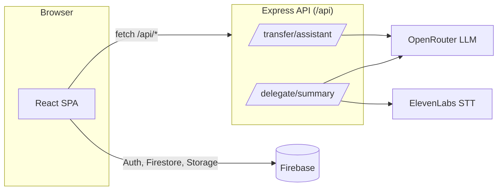

# ICAS Student Life Assistant

A web platform for students of ICAS (International Centre for Applied Sciences, Manipal), built by **Team AXION** for the Enigma Hackathon 2025.

ICAS students follow a **2+2 transfer program**: two years in India, then two years at a partner university abroad. The transfer means deadlines, documents, eligibility rules and a lot of scattered information. This project puts the transfer process, study tools and campus information in one place. Two server-side AI features handle the tedious parts: a transfer Q&A assistant and automatic summaries of recorded meetings.

> **Challenge:** _"Build something that improves the daily life of ICAS students."_

## Team AXION

Jeevith · Shiva Teja · Ali · Charan · Hitesh

## Features

### Public site

- Home, About, Academics, Research, Student Life, Events, News, Faculty, Admissions & Aid, Financial/Medical Aid, Impact and Contact pages
- An explainer for the 2+2 transfer pathway, with an interactive partner-university map
- Light/dark theme, responsive layout with a mobile navigation drawer, skip-to-content link
- **"Ask ICAS"**: a floating helper that maps what you type (e.g. "scholarships", "visa", "gpa") to the right page

### Student portal (`/portal`, sign-in required)

| Feature                                                                                                                                                                                             | Route                  | Storage                                                        |
| --------------------------------------------------------------------------------------------------------------------------------------------------------------------------------------------------- | ---------------------- | -------------------------------------------------------------- |
| Dashboard: deadlines, assignments, announcements, grades, calendar                                                                                                                                  | `/portal`              | Sample data                                                    |
| Courses and assignment submissions                                                                                                                                                                  | `/portal/courses`      | Browser `localStorage`                                         |
| **Smart Transfer Portal**: document checklist with file-name validation, eligibility check against partner-university GPA cutoffs, deadline alerts, progress score, timeline, AI Transfer Assistant | `/portal/transfer`     | `localStorage` in demo mode, Firestore + Storage with Firebase |
| **Delegate Sessions Summary**: upload a meeting recording and get a transcript plus a structured summary (decisions, action items, risks, next steps)                                               | `/portal`              | Processed server-side, not stored                              |
| **Study Centre**: per-course syllabus, rich-text notes, file uploads                                                                                                                                | `/portal/study-centre` | Firebase                                                       |
| **Academic Planner**: GPA calculator, what-if scenarios, course recommendations by prerequisite and semester, transfer-credit check                                                                 | `/portal/planner`      | Firebase                                                       |
| **Buddy System**: mentor/mentee profiles, matching, chat                                                                                                                                            | `/portal/buddies`      | Firebase                                                       |
| **Research Hub**: post projects, apply, team updates                                                                                                                                                | `/portal/research-hub` | Firebase                                                       |
| Admin dashboard (admins only, placeholder cards)                                                                                                                                                    | `/admin`               | —                                                              |

## Tech stack

- **Frontend:** React 18, TypeScript, Vite 7, React Router 7, Tailwind CSS 3, Radix UI / shadcn/ui, Lucide icons, TanStack Query
- **Backend:** Express 5 (integrated into the Vite dev server; standalone Node server or Netlify Function in production), Zod validation, `express-rate-limit`
- **Data and auth:** Firebase Authentication, Cloud Firestore and Firebase Storage. Without Firebase the app falls back to a local demo mode.
- **AI services:** [OpenRouter](https://openrouter.ai) for LLM chat and summarization, [ElevenLabs](https://elevenlabs.io) Scribe for speech-to-text
- **Tooling:** pnpm, Vitest + Supertest, ESLint (typescript-eslint, react-hooks), Prettier

## Architecture



- The React SPA talks to Firebase directly from the browser. Data access is controlled by the Firestore and Storage **security rules** in [`firestore.rules`](firestore.rules) and [`storage.rules`](storage.rules).
- The Express API exists only for calls that need private keys (OpenRouter, ElevenLabs). Keys stay on the server. The AI endpoints are rate-limited per IP and validate their input. Upstream errors are logged on the server and never forwarded to clients.
- **Demo mode vs Firebase mode.** If no `VITE_FIREBASE_*` variables are set at build time, auth uses accounts kept in `localStorage`. The Firebase-only features then show a "setup required" screen instead of failing. Demo mode is for local evaluation only and gives **no real security**.

### API

| Method & path                  | Body                                                                    | Response                             |
| ------------------------------ | ----------------------------------------------------------------------- | ------------------------------------ |
| `GET /api/ping`                | —                                                                       | `{ message }`                        |
| `POST /api/transfer/assistant` | JSON `{ question: string (≤2000 chars), context?: any }`                | `{ answer }`                         |
| `POST /api/delegate/summary`   | Raw audio bytes (`Content-Type: audio/*`), optional `x-filename` header | `{ transcript, summary, modelUsed }` |

Errors use the shape `{ error: string }` with status codes 400, 413, 415, 422, 429, 503 (service not configured) or 500.

## Getting started

### Prerequisites

- Node.js **22+**
- pnpm **10** (`corepack enable` picks up the version pinned in `package.json`)

### Install and run

```bash
git clone https://github.com/jeevithg090/Axion-ICAS-Hacks.git
cd Axion-ICAS-Hacks
pnpm install
cp .env.example .env   # optional: fill in the keys you have
pnpm dev               # http://localhost:8080 (SPA + API on one port)
```

With no configuration the app runs in **demo mode**. Sign in with one of these seeded browser-local accounts, or register a new student:

| Role      | Email              | Password  |
| --------- | ------------------ | --------- |
| Student   | `student@icas.edu` | `icas123` |
| Professor | `prof@icas.edu`    | `icas123` |
| Admin     | `admin@icas.edu`   | `icas123` |

### Environment variables

All variables are listed in [`.env.example`](.env.example).

| Variable                     | Where              | Purpose                                                           |
| ---------------------------- | ------------------ | ----------------------------------------------------------------- |
| `OPENROUTER_API_KEY`         | Server             | Enables the Transfer Assistant and meeting summaries              |
| `ELEVENLABS_API_KEY`         | Server             | Enables meeting transcription                                     |
| `OPENROUTER_ASSISTANT_MODEL` | Server             | Assistant model (default `openrouter/auto`)                       |
| `OPENROUTER_SUMMARY_MODELS`  | Server             | Comma-separated fallback model list for summaries                 |
| `APP_URL`                    | Server             | Public URL, sent to OpenRouter as `HTTP-Referer`                  |
| `CORS_ORIGINS`               | Server             | Extra origins allowed to call the API (default: same-origin only) |
| `AI_RATE_LIMIT_PER_MINUTE`   | Server             | Per-IP limit for AI endpoints (default 10)                        |
| `MAX_AUDIO_UPLOAD`           | Server             | Max recording size (default `25mb`)                               |
| `TRUST_PROXY`                | Server             | Reverse-proxy hops to trust for client IPs (default 1)            |
| `PORT`                       | Server             | Port for `pnpm start` (default 3000)                              |
| `VITE_FIREBASE_*`            | Client, build time | Firebase web app config. Leave empty for demo mode.               |

Server variables are secrets: keep them out of git and out of any `VITE_` variable. The `VITE_FIREBASE_*` values end up in the browser bundle by design. Firebase web config is not a secret, so protect your data with the security rules and, ideally, App Check.

### Setting up Firebase (optional)

1. Create a Firebase project and add a **Web app**. Copy its config into the `VITE_FIREBASE_*` variables.
2. Enable **Authentication → Email/Password**, **Cloud Firestore** and **Storage**.
3. Deploy the security rules:
   ```bash
   npx firebase-tools login
   npx firebase-tools deploy --only firestore:rules,storage --project <your-project-id>
   ```
4. Rebuild or restart the dev server. New sign-ups are always students. To make an admin, set `role: "admin"` on their `users/{uid}` document in the Firebase console.

## Scripts

| Command                             | Description                                                  |
| ----------------------------------- | ------------------------------------------------------------ |
| `pnpm dev`                          | Dev server with hot reload (client + API) on port 8080       |
| `pnpm build`                        | Production build: SPA → `dist/spa`, server → `dist/server`   |
| `pnpm start`                        | Run the production server (`dist/server/node-build.mjs`)     |
| `pnpm test`                         | Run the Vitest suite once (`pnpm test:watch` for watch mode) |
| `pnpm lint` / `pnpm lint:fix`       | ESLint                                                       |
| `pnpm format` / `pnpm format:check` | Prettier                                                     |
| `pnpm typecheck`                    | TypeScript (`tsc --noEmit`)                                  |
| `pnpm check`                        | Typecheck, lint, format check and tests in one go            |

## Testing

The tests cover the core logic and the API:

- `client/lib/*.spec.ts`: GPA and projected-GPA maths, course recommendations, transfer-credit validation, transfer progress, eligibility, next-step and file-name rules, demo-account handling, open-redirect protection
- `server/**/*.spec.ts`: request validation, error mapping, rate limiting, the transcription → summarization pipeline with model fallback, and LLM JSON parsing. External APIs are mocked, so tests need no keys or network.

## Deployment

### Node server (any VPS / PaaS)

```bash
pnpm install --frozen-lockfile
pnpm build
NODE_ENV=production pnpm start
```

The server serves the SPA from `dist/spa`, handles `/api/*`, and falls back to `index.html` for client-side routes. Set the server environment variables on the host. Set `VITE_FIREBASE_*` **before** `pnpm build`.

### Netlify

[`netlify.toml`](netlify.toml) builds the SPA, deploys the Express app as the `api` function (`netlify/functions/api.ts`) and sets up the `/api/*` and SPA fallback redirects. Add the environment variables in the Netlify UI. Netlify Functions limit request bodies to about 6 MB, so long meeting recordings need the Node server deployment instead.

## Project structure

```
client/                     React SPA
├── App.tsx                 Routes (lazy-loaded) and providers
├── components/
│   ├── auth/               Protected, RequireRole, RequireFirebase guards
│   ├── layout/             Header (with mobile drawer), Footer, SiteLayout
│   ├── sections/           Home/portal sections (incl. DelegateSessionsSummary)
│   └── ui/                 shadcn/ui primitives
├── context/AuthContext.tsx Unified auth: Firebase or local demo mode
├── data/sample.ts          Sample content and demo accounts
├── lib/                    Domain logic (transfer, planner, buddy, research, study centre, auth helpers)
└── pages/                  Route components
server/
├── index.ts                Express app (middleware, routes, error handling)
├── node-build.ts           Production entry: static SPA + API
├── lib/                    OpenRouter client, audio helpers, error types
└── routes/                 /api/transfer/assistant, /api/delegate/summary
shared/api.ts               Request/response types shared by client and server
netlify/functions/api.ts    Netlify Function wrapper around the Express app
firestore.rules             Firestore security rules
storage.rules               Storage security rules
```

## Known limitations

- The admin dashboard and the portal dashboard use static sample data.
- Demo mode stores accounts and passwords in the browser's `localStorage`. It is for demos only.
- The Firestore/Storage rules have not been run against the Firebase emulator. Review them for your data model before production use.
